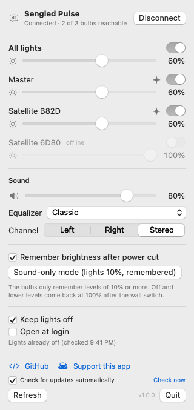

# PulseBar: Sengled Pulse control for macOS

Control your **Sengled Pulse Classic** (the JBL speaker bulb, `C01-BR30`) and its satellite bulbs right from
your Mac's menu bar. It's built for people who want to control their bulbs from the convenience of their
computer.

<p align="center">
  <picture>
    <source media="(prefers-color-scheme: dark)" srcset="docs/menubar-dark.png">
    
  </picture>
</p>

<p align="center">
  <a href="https://buymeacoffee.com/digitalducktape"></a>
</p>

## What it does

- Turn the lights on and off and set the brightness, for every bulb at once or one at a time. Can't tell
  which bulb is which? Click the sparkle and it'll blink.
- Adjust the speaker: volume, mute, equalizer (Normal, Pop, Jazz, Classic, Rock, Movie) and left, right or
  stereo.
- Turn on **Remember brightness after power cut**, a setting tucked away inside the bulb.
- Use **Sound-only mode** if you mostly use your Pulse as a speaker. It dims the lights to 10%, the lowest
  level the bulbs will remember when the power goes out.
- Turn on **Keep lights off** and PulseBar switches the lights off whenever the bulb is free, then hands it
  back to your Echo. More on that [below](#keeping-the-lights-off-with-an-echo).
- It can open at login and will let you know when there's a new version.

Prefer the terminal? There's also `pulsectl`, a command-line tool with the same controls, and `PulseKit`,
the Swift library that does the talking to the bulb.

## Getting started

1. Pair the **master** bulb in **System Settings → Bluetooth**. The satellites talk to the master, so you
   don't need to pair them.
2. Grab `PulseBar.zip` from the [latest release](https://github.com/digitalducktape/sengled-pulse-control/releases/latest),
   unzip it, and drag **PulseBar.app** into your Applications folder.
3. PulseBar isn't notarized by Apple, so macOS will hold it back the first time. Open it once, then head to
   **System Settings → Privacy & Security** and click **Open Anyway**.
4. Say yes when macOS asks about Bluetooth, then click the lightbulb in your menu bar.

PulseBar checks GitHub for a new version when it starts and once a day after that. It doesn't send anything
about you or your bulbs. If you'd rather it didn't check, untick the box at the bottom of the panel.

## Building it yourself

All you need are the Xcode Command Line Tools (no full Xcode required):

```bash
scripts/install.sh
```

That builds PulseBar, copies it to `~/Applications` and opens it. If you only want the app bundle, use
`scripts/bundle.sh PulseBar`, which leaves it in `build/PulseBar.app`.

One heads-up: every local build gets a fresh signature, so macOS asks for Bluetooth permission again after
each rebuild. Until you click Allow, the app just waits patiently.

Run the tests with `swift test`.

### From the command line

macOS only hands out Bluetooth access to apps, so `pulsectl` runs inside a small app bundle.
`scripts/pulsectl` takes care of that for you:

```bash
scripts/pulsectl status
```

```bash
scripts/pulsectl light 40            # every bulb to 40%
```

```bash
scripts/pulsectl off 0000B82D        # switch off one satellite
```

Run `scripts/pulsectl` on its own to see every command, or add `--verbose` to watch the messages going back
and forth.

### Updating the screenshots

The pictures above come straight from the app, drawn with sample data, so you don't need a bulb nearby:

```bash
build/PulseBar.app/Contents/MacOS/PulseBar --screenshot docs/menubar-light.png
```

## Keeping the lights off with an Echo

Here's the catch: the Pulse only talks to **one Bluetooth device at a time**. While your Echo is playing
music through it, nothing else can reach the light. And whenever the power blinks, the bulbs come back on at
full brightness.

PulseBar can't change how the bulb behaves, but it can turn fixing it into a single phrase:

1. In PulseBar, turn on **Keep lights off** and **Open at login**.
2. In the Alexa app, create a routine (say, **"Alexa, lights out"**) with three steps:
   - *Customized*: `disconnect Bluetooth`
   - *Wait*: 30 seconds, which gives PulseBar time to switch the lights off
   - *Customized*: `connect to C01-BR30`

While the Echo has the bulb, PulseBar tries again every 10 seconds. Once the lights are off, it checks back
every few minutes. Your Mac does need to be on, awake, and within Bluetooth range of the master bulb.

Don't want to leave a Mac running? **Sound-only mode** keeps the lights at 10% through power cuts with
nothing running at all.

## What we learned about the bulb

The master bulb has a classic Bluetooth serial port (SPP, RFCOMM channel 1, named "SPP Dev"). Commands are
small framed messages: `7E | source | destination | subsystem | command | body | checksum | 00 | 7E`. The
master passes along anything meant for a satellite. The full command list lives in
`Sources/PulseKit/Commands.swift`.

Here's what we confirmed on real bulbs (one master and one satellite, November 2026):

| Behavior | Result |
|---|---|
| Handshake, list of bulbs, light and speaker status | ✅ Works on master and satellite |
| On/off and brightness, all bulbs or one | ✅ Works |
| Brightness levels | Each bulb reports two (a *group* level and its *own*), and the light shows the lower one |
| The Pulse Link's extra "apply" brightness message | ❌ Resets a Classic to 100%, so PulseBar skips it |
| Remember-brightness setting | A simple on/off, and the only setting the bulb has |
| Brightness after a power cut, with that setting on | **10% or higher sticks. Anything lower, or off, comes back at 100%** |
| Waiting 2 minutes before cutting the power | Makes no difference. The 10% floor is built in |
| A second Bluetooth device while one is connected | ❌ The bulb only accepts one at a time |

Keeping the light fully off after a power cut would take new firmware in the bulb, and this project doesn't
go there.

### Quirks worth knowing

- Right after a connection closes, the bulb needs a few seconds before it'll accept a new one.
- After a power cut, the bulb reconnects to the Mac by itself but won't take commands on that connection.
  PulseBar fixes this by reconnecting from the Mac's side, which briefly interrupts any audio the Mac is
  playing.
- While PulseBar's panel is connected, your Echo can't connect. Click **Disconnect** to hand the bulb back.
- Satellites that are switched off still show up in the list, marked *offline*.
- The two projects this builds on disagree about which channel is left and which is right. If yours come out
  swapped, flip them in `SoundChannel` in `Sources/PulseKit/Commands.swift`.

## What about Alexa?

An Echo can only use the bulb as a speaker. Alexa has no way to send the bulb's light commands, and Alexa
skills run in Amazon's cloud, which can't reach a Bluetooth device in your home. That's why the routine above
works by briefly handing the bulb over to your Mac.

## Credits

PulseBar is its own Swift implementation, but it wouldn't exist without the people who figured out how these
bulbs talk. Their published documentation taught us the protocol; no code was copied.

- **[amchen/sengled-pulse-classic](https://github.com/amchen/sengled-pulse-classic)** (GPL-2.0): an Android
  controller for the Pulse master bulb. It documented the message format, the core light and speaker
  commands, the backwards on/off flag, and the example message we use as a test in `FrameTests.swift`.
- **[kernelorg/sengled-pulse-link](https://github.com/kernelorg/sengled-pulse-link)**: a deep dive into the
  Pulse Link, with a Python tool and an ESPHome component. It documented the wider command set (listing
  bulbs, talking to one bulb at a time, the remember-brightness setting, blinking a bulb, bulb names, audio
  source), how to pick messages out of the data stream, and the timing (80 ms between messages, 3 seconds to
  wait for a reply).

We also looked at these two. They cover other Sengled products, so nothing from them ended up here, but
they're worth a look if you have other Sengled gear:

- [snwagbata/luminar](https://github.com/snwagbata/luminar) (MIT): a Flutter app for Sengled Bluetooth Mesh bulbs.
- [jfarmer08/sengled-api](https://github.com/jfarmer08/sengled-api) (MIT): a Node.js client for Sengled's cloud API.

Sengled and JBL are trademarks of their owners. This project isn't affiliated with or endorsed by either,
and it's meant for personal use with bulbs you own.

## Support

If PulseBar gave your Pulse bulbs a second life, you can
[buy me a coffee](https://buymeacoffee.com/digitalducktape). Thank you!
